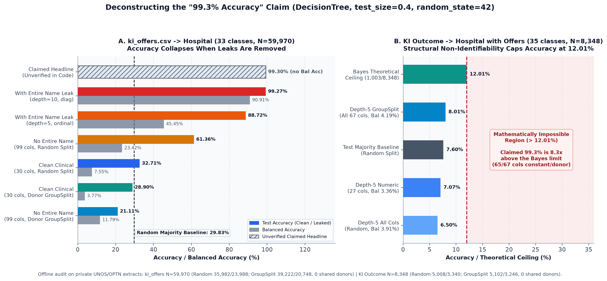
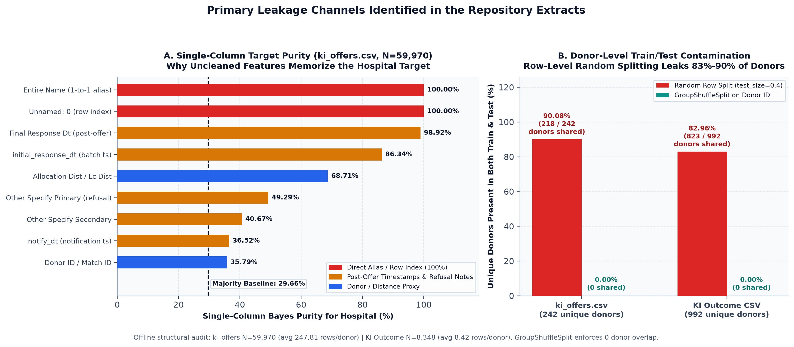
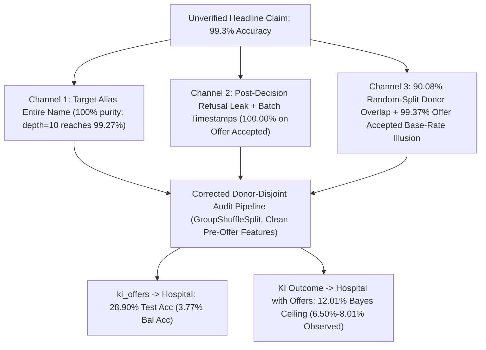
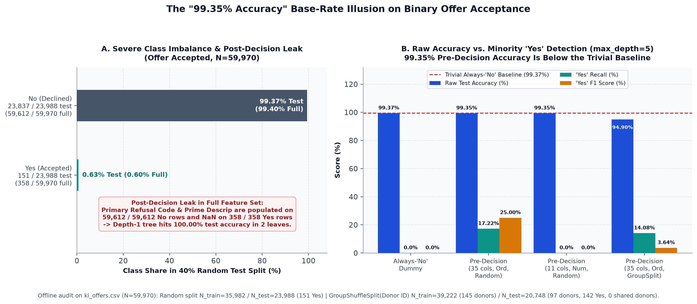

# transplantation-offer-audit

Leakage audit and reproducible refactor of the kidney transplantation offer modeling codebase.

## 1. Original Claim & Defect

The original modeling script (`Transplantation_Model_01.py`) targeted `"Hospital with Offers"` with `DecisionTreeClassifier(max_depth=5, random_state=42)` and `train_test_split(..., test_size=0.4, random_state=42)`, alongside an unverified headline claim of **99.3% accuracy**. In practice, the script pointed to a hardcoded Windows OneDrive Excel path (`test.xlsx`), lacked categorical encoding, and only printed `export_text(...)` without computing any evaluation metric.

## 2. What the Audit Found



Offline auditing on the private UNOS/OPTN extracts (`ki_offers.csv`: $N = 59{,}970$, 242 donors; `KI Outcome`: $N = 8{,}348$, 992 donors) established that **99.3% accuracy is indefensible**:

- **Direct target alias (`Entire Name` ↔ `Hospital`):** 1-to-1 bijection across all 33 hospitals (`100.00%` single-column purity). Even with this leak, `max_depth=5` hits only `88.72%` (`ordinal`) or `71.05%` (`one-hot`); hitting `99.27%` requires `max_depth=10` to memorize the name-to-code map.
- **Post-decision refusal leak (`Offer Accepted`):** `Primary Refusal Code` and `Prime Descrip` are non-null on all `59,612` `No` rows and `NaN` on all `358` `Yes` rows (`100.00%` accuracy in 2 leaves).
- **Donor overlap between train and test:** Random 60/40 row splits put **218 / 242 donors (90.1%)** in both train and test. Switching to donor-disjoint `GroupShuffleSplit` drops `Hospital` accuracy (99 cols minus `Entire Name`) from **61.36%** to **21.11%**.
- **Base-rate illusion (`Offer Accepted`):** `99.40%` of offers are `No` (`99.37%` in the random test split). On 35 clean pre-decision features, `max_depth=5` achieves **99.35%** raw accuracy — **worse than the 99.37% trivial always-`No` baseline**, with `17.22%` recall on `Yes` (`0.00%` numeric-only).
- **Theoretical identifiability ceiling (`Hospital with Offers` in `KI Outcome`):** 65 of 67 non-ID columns are invariant per donor (`1,003` unique feature rows out of `8,348`), capping Bayes-optimal accuracy at **12.01%**.





## 3. Defensible Offline Benchmark Numbers (`max_depth=5`, `test_size=0.4`)



| Target & Dataset | Split & Feature Scope | Test Baseline | Test Accuracy | Balanced Acc |
|---|---|---:|---:|---:|
| `Hospital` (`ki_offers`, $N=59{,}970$) | `GroupShuffleSplit(Donor ID)`, 99 cols (no `Entire Name`) | 30.85% | **21.11%** | 11.79% |
| `Hospital` (`ki_offers`, $N=59{,}970$) | Random split, 30 clean pre-offer clinical cols | 29.83% | **32.71%** | 7.55% |
| `Hospital` (`ki_offers`, $N=59{,}970$) | `GroupShuffleSplit(Donor ID)`, 30 clean clinical cols | 30.85% | **28.90%** | 3.77% |
| `Hospital with Offers` (`KI Outcome`, $N=8{,}348$) | Random / Group split (Bayes ceiling = **12.01%**) | 7.60% / 7.02% | **6.50%–8.01%** | 3.91%–4.19% |
| `Offer Accepted` (`ki_offers`, $N=59{,}970$) | Random split, 35 pre-decision cols | 99.37% | **99.35%** | 58.54% (`Yes` F1=0.25) |

See [`AUDIT.md`](AUDIT.md) for full details, feature purities, and sample counts.

## 4. Quickstart (`100% Synthetic` Sample Data Included)

> **Privacy notice:** Private `.csv` and `.xlsx` files under `data/` are strictly excluded by `.gitignore`. This repository ships only **100% synthetic** schema-matched fixtures in [`sample_data/`](sample_data/README.md) so the ETL and evaluation pipelines can run end to end without real patient or donor records.

```bash
# 1. Install dependencies (Python 3.11+ recommended)
pip install -r requirements.txt

# 2. (Optional) Regenerate synthetic sample CSVs
python3 src/scripts/generate_synthetic_data.py

# 3. Run ETL pipeline against in-memory SQLite using synthetic data
python3 src/scripts/create_db.py --sqlite :memory:

# 4. Run leakage audit & evaluation script (defaults to sample_data/ when data/ is absent)
python3 src/scripts/eval_transplantation.py

# 5. (Optional) Regenerate audit figures in assets/
python3 src/scripts/generate_figures.py
```

To evaluate private local files (stored in the gitignored `data/` folder) offline:

```bash
python3 src/scripts/eval_transplantation.py \
  --offers-csv data/ki_offers.csv \
  --outcomes-csv "data/KI Outcome Download_data 10.1.20-9.30.23.csv"
```
